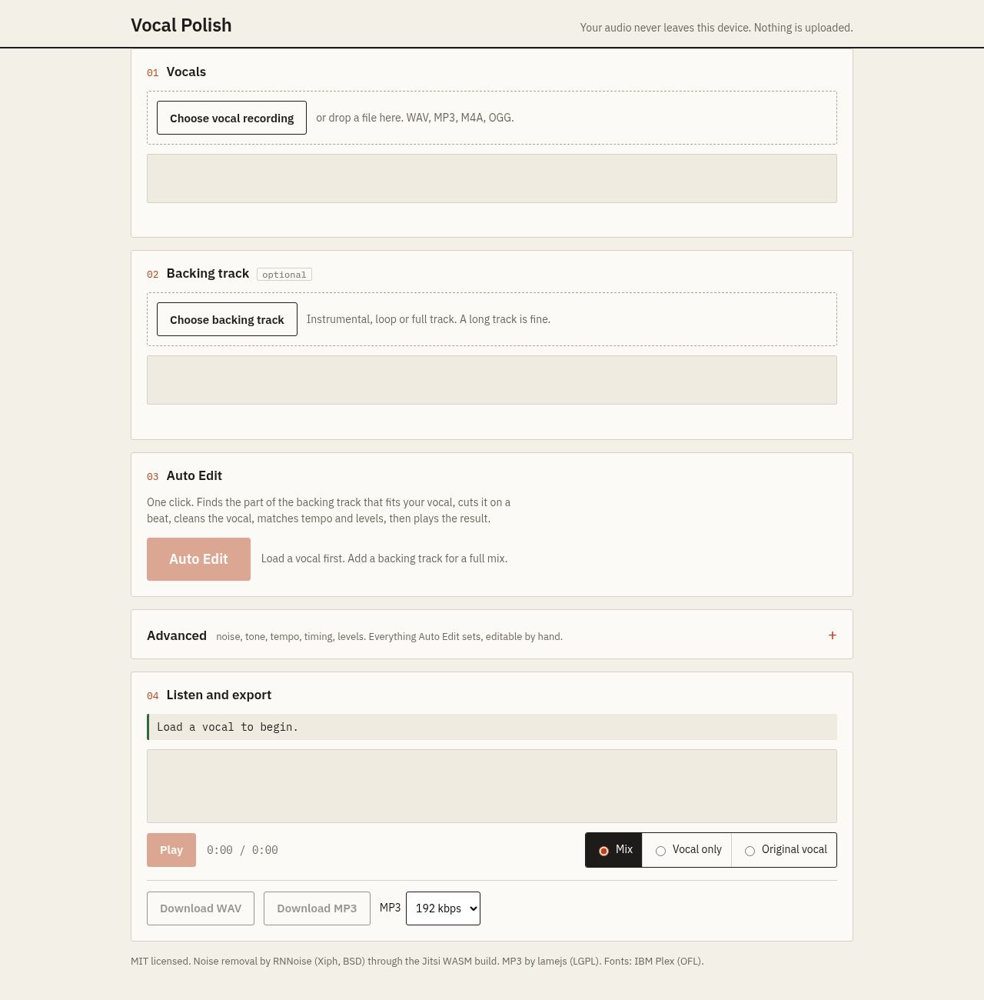
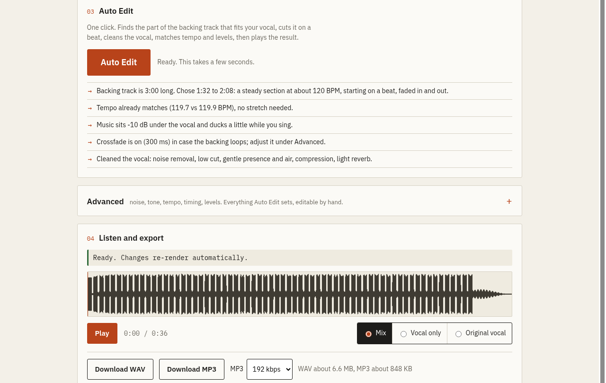

# Vocal Polish


Clean up a vocal recording and mix it with a backing track, entirely in your browser.

**Live:** https://dev-stack12692.github.io/vocal-polish/



Your audio never leaves your device. There is no server, no account and no paid API. After the page loads (about 300 KB including the 112 KB noise model, which loads only if you switch noise removal on), it works offline.

## What it does

**Auto Edit.** One click: finds the part of the backing track that best fits your vocal (close tempo, steady energy, starting on a beat), cuts it with musical fades, cleans the vocal, matches tempo and levels, and plays the result. It tells you every choice it made. Every control it uses stays editable under **Advanced**.



1. **Noise removal.** RNNoise (the Xiph neural denoiser, compiled to WebAssembly) removes hiss, fan and room noise. A strength slider blends the cleaned and original vocal.
2. **Tone.** Low cut, warmth, presence and air EQ, a compressor, and a small generated-room reverb.
3. **Tempo match.** Detects BPM of the vocal and the backing track (you can correct it, or halve or double it) and time-stretches the backing to the vocal with WSOLA, so pitch stays the same.
4. **Auto balance.** Both tracks are measured with a gated RMS meter. The music sits a set number of dB under the vocal, and can duck 4 dB while the vocal is singing.
5. **Loop crossfade.** When the backing track is shorter than the vocal it loops, and every join is blended with an equal-power crossfade (50-1500 ms, adjustable) so there is no click at the repeat.
6. **Timing.** A vocal offset slider (-1000 to +1000 ms, 1 ms steps) to line the vocal up with the beat.
7. **Export.** 16-bit WAV, or MP3 at 128, 192 or 256 kbps.

You can preview the full mix, the processed vocal alone, or the original vocal, at matched loudness.

## Use it

Open the live page, then:

1. Pick your vocal file (WAV, MP3, M4A, OGG, whatever your browser can decode).
2. Optionally add a backing track - a long one is fine.
3. Press **Auto Edit**. It picks the best section of the backing track, cleans the vocal, matches tempo and levels, and plays the mix. Download WAV or MP3.

Want control instead? Open **Advanced**: every slider is there and changes re-render automatically. If the tempo guess is off by half or double, use the buttons next to the BPM boxes.

## Honest limits

- BPM detection works best on tracks with clear drums. On a vocal with no beat it is a guess, so check the number.
- The tempo match changes the backing, not the vocal. Large changes (beyond about 25%) start to sound processed. The limit is 0.5x to 2x.
- Compression and reverb use the browser's built-in audio nodes. They are good for tidying a take, not a replacement for a full mixing session.
- It does not compose music. You bring the backing track.
- Long files use memory. A 5 minute stereo track is fine on a recent phone or laptop.

## Run locally

It is a static site with no build step. ES modules need a web server (opening the file directly will not work):

```
python3 -m http.server 8000
```

Then open http://localhost:8000.

## Files

The repo is flat on purpose, so it can be edited from any device.

```
index.html, style.css      page and styles
app.js                     interface and playback
engine.js                  vocal chain (Web Audio) and mixdown
dsp.js                     RNNoise wrapper, BPM detection, WSOLA, loop crossfade, WAV and MP3 encoders
logo.svg, logo-*.png       app logo and favicons
screenshot-*.png           images used in this README
rnnoise.js, rnnoise.wasm   noise model (Jitsi build of RNNoise)
lame.min.js                MP3 encoder (lamejs)
*.woff2                    IBM Plex fonts, latin subset
LICENSE-*.txt              third-party licenses
```

## Credits

- [RNNoise](https://gitlab.xiph.org/xiph/rnnoise) by Jean-Marc Valin (BSD), WASM build from [jitsi/rnnoise-wasm](https://github.com/jitsi/rnnoise-wasm) (Apache-2.0).
- [lamejs](https://github.com/zhuker/lamejs) MP3 encoder (LGPL-3.0), shipped unmodified as a separate file.
- IBM Plex fonts (SIL OFL 1.1).

## License

MIT for this project's own code. See `LICENSE`.
